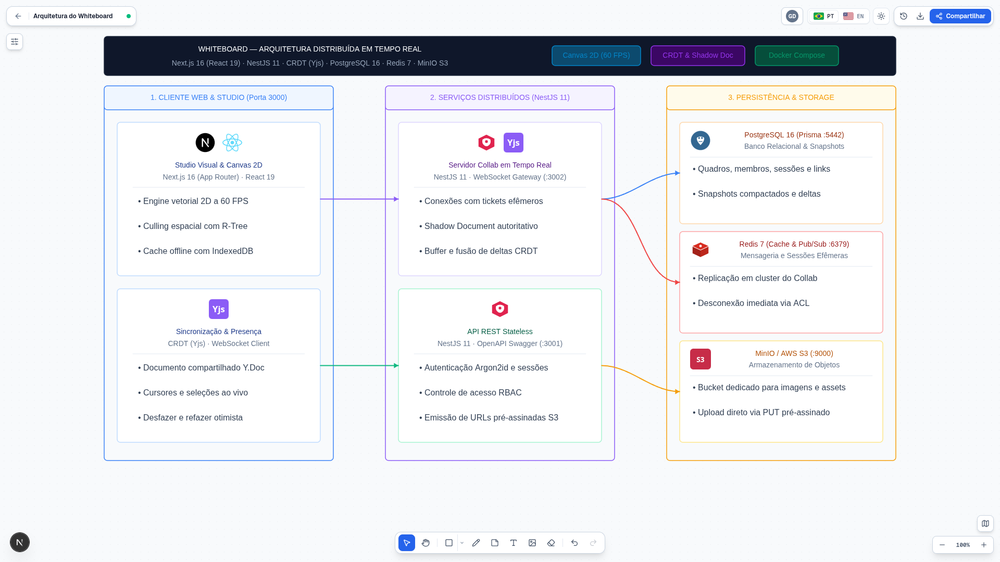
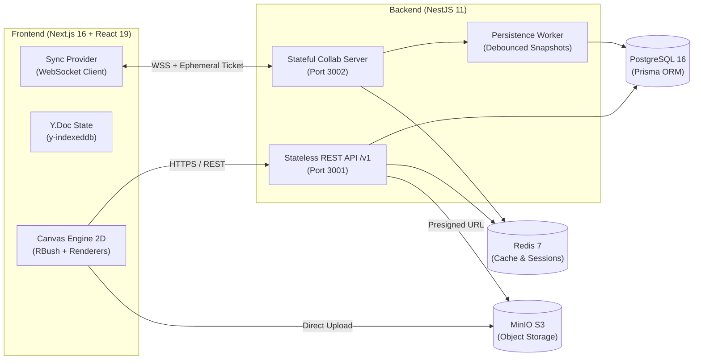

# 🎨 Whiteboard

> A production-grade real-time collaborative infinite canvas platform powered by CRDT (Yjs), distributed microservices (stateless REST API + stateful WebSocket Collab server), PostgreSQL relational storage via Prisma, Redis caching and pub/sub cluster replication, and MinIO S3 object storage.

[](https://www.typescriptlang.org/)
[](https://nextjs.org/)
[](https://react.dev/)
[](https://nestjs.com/)
[](https://tailwindcss.com/)
[](https://www.postgresql.org/)
[](https://redis.io/)
[](https://www.docker.com/)

---

<div align="center">
  
  <p><em>System architecture diagram and interactive preview rendered directly on the Whiteboard 2D canvas engine</em></p>
</div>

---

## 📋 About The Project

**Whiteboard** is a high-performance visual collaboration platform engineered for absolute data consistency across distributed clients. Inspired by industry-leading tools like Miro, Figma, and Excalidraw, Whiteboard implements a **custom 2D canvas rendering engine** and adopts **CRDTs (Conflict-free Replicated Data Types)** via the [Yjs](https://github.com/yjs/yjs) ecosystem to ensure seamless concurrent editing with mathematical convergence, zero data collisions, and low latency.

---

## 🌐 Local Services & Endpoints Reference

When starting the local environment, the following services are available:

| Service | Connection / URL | Description | Default Credentials / Notes |
| :--- | :--- | :--- | :--- |
| **Frontend Studio** | [http://localhost:3000](http://localhost:3000) | Web studio & interactive 2D canvas | Interactive drawing and collaboration |
| **REST API** | [http://localhost:3001](http://localhost:3001) | Stateless NestJS API (`/v1/*`) | Authentication, board CRUD, presigned URLs |
| **Swagger UI** | [http://localhost:3001/v1/docs](http://localhost:3001/v1/docs) | Interactive OpenAPI documentation | Complete endpoint catalogue and schemas |
| **Collab Server** | `ws://localhost:3002/collab` | Stateful WebSocket server (NestJS + Yjs) | Real-time room synchronization & awareness |
| **MinIO Console** | [http://localhost:9001](http://localhost:9001) | S3 Object Storage Dashboard | User: `minio` \| Pass: `minio12345` |
| **MinIO API** | [http://localhost:9000](http://localhost:9000) | S3 endpoint for direct file uploads | Default bucket: `whiteboard-assets` |
| **PostgreSQL** | `localhost:5442` | Relational database (Prisma) | User: `whiteboard` \| Pass: `whiteboard123` |
| **Redis** | `localhost:6379` | In-memory cache & Pub/Sub cluster | Session management and multi-pod replication |

---

## 🧱 System Architecture



### Architectural Principles

1. **Stateless vs. Stateful Isolation**: The REST API manages account lifecycles, permissions, and metadata in a purely stateless manner, allowing seamless horizontal scaling. The Collab Server maintains active room documents in memory only while WebSocket clients are connected, persisting debounced snapshots to PostgreSQL.
2. **Authoritative Server Shadow Document**: While client canvas rendering is optimistic and immediate, the Collab Server maintains an authoritative Shadow Document that validates every delta against Zod schemas, spatial limits, and room element caps (5,000 nodes).
3. **Two Autonomous Repositories**: The frontend and backend maintain isolated Git submodules with dedicated dependencies, build steps, and deployment pipelines.

---

## 🚀 Quickstart

### Prerequisites

Ensure the following tools are installed:
- [Node.js](https://nodejs.org/) (`20.x` or `22.x` LTS)
- [npm](https://www.npmjs.com/) (`10.x+`)
- [Docker](https://www.docker.com/get-started) and [Docker Compose](https://docs.docker.com/compose/) v2+
- [Make](https://www.gnu.org/software/make/)

---

### Option 1: Run All Services via Docker Compose (Recommended)

Starts all containers (database, cache, S3, migrations, API, Collab, and Frontend) in a single step:

1. **Clone the repository with submodules**
   ```bash
   git clone --recurse-submodules https://github.com/GabrielFeijo/whiteboard.git
   cd whiteboard
   ```

2. **Configure environment and boot containers**
   ```bash
   make env
   make up
   ```

3. **Check container health**
   ```bash
   make ps
   ```

4. **Access the services**
   - Frontend Studio: [http://localhost:3000](http://localhost:3000)
   - Swagger API Docs: [http://localhost:3001/v1/docs](http://localhost:3001/v1/docs)
   - MinIO Storage Console: [http://localhost:9001](http://localhost:9001)

---

### Option 2: Local Development with Hot Reload

For rapid development workflows:

1. **Start infrastructure dependencies (Postgres, Redis, MinIO)**
   ```bash
   make deps
   ```

2. **Run migrations and seed the database**
   ```bash
   npm --prefix backend run prisma:migrate
   npm --prefix backend run db:seed
   ```

3. **Start development servers**
   ```bash
   # Run both backend and frontend concurrently
   make dev
   ```

---

## 📦 Workspace Topology

```text
whiteboard/
├── backend/                      # NestJS 11 API and Collab Server submodule
│   ├── prisma/                   # Relational schema and migrations
│   ├── src/
│   │   ├── core/                 # Prisma, Redis, S3, and Observability
│   │   ├── modules/              # Auth, Boards, Assets, Collab, and Persistence
│   │   ├── shared/               # Authoritative contract source of truth (Zod, Types, Protocol)
│   │   ├── main.api.ts           # REST API entrypoint (Port 3001)
│   │   └── main.collab.ts        # Collab WebSocket server entrypoint (Port 3002)
│   └── package.json
│
├── frontend/                     # Next.js 16 Web Studio submodule
│   ├── src/
│   │   ├── app/                  # App Router pages and layouts
│   │   ├── canvas/               # Custom 2D Canvas Engine, Spatial Index, Renderers, and Tools
│   │   ├── collab/               # WebSocket Sync Provider, Awareness, and Undo Manager
│   │   ├── features/             # Domain modules (auth, boards, studio, share)
│   │   ├── i18n/                 # Translation dictionaries (PT/EN)
│   │   └── shared/               # Synchronized contract replica from backend
│   └── package.json
│
├── docs/                         # Architecture, guides, and ADRs
│   ├── adr/                      # Architecture Decision Records
│   ├── architecture.md           # System architecture specification
│   ├── DEVELOPMENT.md            # Local developer guide
│   ├── TESTING.md                # Testing handbook
│   ├── PROTOCOL.md               # Real-time CRDT & WebSocket protocol specification
│   ├── CONTRIBUTING.md           # Contribution and submodule guidelines
│   └── tasks/                    # Epic and task backlog
│
├── docker-compose.yml            # Complete orchestration (App + Infrastructure)
├── docker-compose.deps.yml       # Infrastructure-only orchestration
├── Makefile                      # Developer and agent task harness
├── AGENTS.md                     # Master guidelines and invariants for AI agents
├── CLAUDE.md                     # Claude Code CLI operational guide
├── .cursorrules                  # Cursor IDE agent instructions
└── README.md                     # Root project documentation
```

---

## 📝 Makefile Commands

A unified `Makefile` automates all common developer tasks:

```bash
# Verification & Quality
make check         # Full validation: contract check, typecheck, lint, and all 189+ tests
make check-quick   # Fast validation: contract check, typecheck, tests (skips linter)
make test          # Run all Vitest unit and contract tests across both submodules
make typecheck     # Run TypeScript type checking across both projects
make lint          # Run ESLint across both projects
make sync-shared   # Copy shared contracts from backend to frontend
make sync-shared-check # Verify contract parity

# Infrastructure & Containers
make deps          # Start infrastructure services (Postgres, Redis, MinIO)
make up            # Build and start all services via Docker Compose
make down          # Stop all Docker containers
make logs          # Tail container logs
make ps            # List running container status and ports
make reset         # Stop containers and remove persisted volumes
```

---

## 🧪 Testing & Quality Assurance

Both submodules feature rigorous, sub-second test suites:

```bash
# Backend test suite (15 suites, 71 tests)
npm --prefix backend run test

# Frontend test suite (21 suites, 118 tests)
npm --prefix frontend run test

# Full verification harness across the entire workspace
make check
```

---

## 📚 Technical Documentation & Guides

- **AI Agent Guidelines**: [`AGENTS.md`](./AGENTS.md) · [`CLAUDE.md`](./CLAUDE.md) · [`.cursorrules`](./.cursorrules)
- **Local Development Guide**: [`docs/DEVELOPMENT.md`](./docs/DEVELOPMENT.md)
- **Testing Handbook**: [`docs/TESTING.md`](./docs/TESTING.md)
- **CRDT & Collab Protocol**: [`docs/PROTOCOL.md`](./docs/PROTOCOL.md)
- **Contributing & Submodules Protocol**: [`docs/CONTRIBUTING.md`](./docs/CONTRIBUTING.md)
- **System Architecture**: [`docs/architecture.md`](./docs/architecture.md)
- **Architecture Decision Records (ADRs)**: [`docs/adr/`](./docs/adr/)
- **Task Backlog**: [`docs/tasks/00-index.md`](./docs/tasks/00-index.md)
