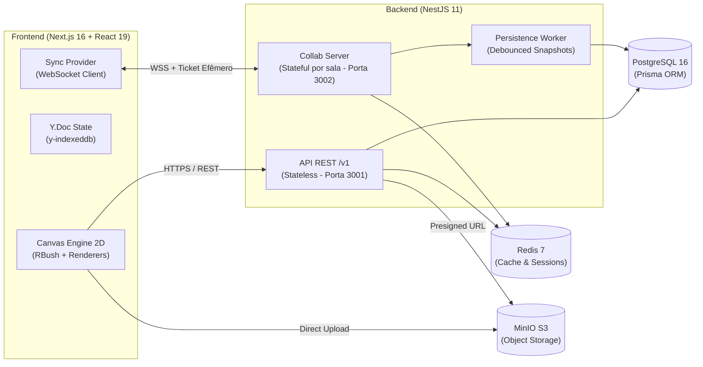

# 🎨 Whiteboard

> Plataforma completa de quadro branco infinito com sincronização multiusuário em tempo real orientada a CRDT (Yjs), arquitetura distribuída em microsserviços (API REST stateless + Collab WebSocket server), persistência relacional com PostgreSQL/Prisma, cache Redis e armazenamento de objetos MinIO/S3.

[](https://www.typescriptlang.org/)
[](https://nextjs.org/)
[](https://react.dev/)
[](https://nestjs.com/)
[](https://tailwindcss.com/)
[](https://www.postgresql.org/)
[](https://redis.io/)
[](https://www.docker.com/)
---

<div align="center">
  
  <p><em>Quadro de arquitetura do sistema e preview interativo renderizado diretamente na engine 2D do Whiteboard</em></p>
</div>

---

## 📋 Sobre o Projeto

O **Whiteboard** é uma plataforma de colaboração visual em tempo real projetada com foco em alta performance, robustez e consistência de dados distribuídos. Inspirado nas melhores experiências de ferramentas como Miro, Figma e Excalidraw, o projeto implementa uma **engine de canvas 2D proprietária** e adota o padrão **CRDT (Conflict-free Replicated Data Types)** através do ecossistema [Yjs](https://github.com/yjs/yjs) para garantir que múltiplos usuários desenhem, escrevam e organizem elementos no mesmo quadro simultaneamente, sem colisões de dados e com baixa latência.

---

## 🌐 Demonstração Local & Serviços

Ao subir o ecossistema localmente, os seguintes serviços estarão disponíveis:

| Serviço | URL / Conexão | Descrição | Credenciais / Notas |
| :--- | :--- | :--- | :--- |
| **Frontend** | [http://localhost:3000](http://localhost:3000) | Aplicação Web / Whiteboard Studio | Interface do usuário e canvas interativo |
| **API REST** | [http://localhost:3001](http://localhost:3001) | Servidor REST (NestJS) | Rotas de autenticação, boards e assets |
| **Swagger Docs** | [http://localhost:3001/v1/docs](http://localhost:3001/v1/docs) | Documentação OpenAPI interativa | Catálogo completo de endpoints e schemas |
| **Collab Server** | `ws://localhost:3002` | Gateway WebSocket (NestJS + Yjs) | Sincronização em tempo real por sala |
| **MinIO Console** | [http://localhost:9001](http://localhost:9001) | Dashboard do Object Storage S3 | Usuário: `minio` \| Senha: `minio12345` |
| **MinIO API** | [http://localhost:9000](http://localhost:9000) | Endpoint S3 de assets e uploads | Bucket padrão: `whiteboard-assets` |
| **PostgreSQL** | `localhost:5442` | Banco de Dados Relacional | Usuário: `wb` \| Senha: `wb` \| Banco: `whiteboard` |
| **Redis** | `localhost:6379` | Cache e Pub/Sub em memória | Gerenciamento de sessões e presença |

---

## 🧱 Arquitetura do Sistema



### Princípios da Arquitetura

1. **Separação Stateless vs. Stateful**: A API REST cuida do ciclo de vida das contas, permissões e metadados de forma puramente stateless, podendo escalar horizontalmente. O servidor Collab mantém as salas ativas na memória apenas enquanto houver conexões WebSocket ativas, persistindo snapshots no Postgres periodicamente.
2. **Autoridade Híbrida com CRDT**: A renderização e a edição no canvas são imediatas e sem latência percebida para o usuário (otimista). O servidor atua como autoridade para verificação de permissões e broadcast dos deltas binários compactados.
3. **Desacoplamento em 2 Repositórios Git**: O frontend e o backend possuem ciclos de vida e dependências separadas, permitindo deploy independente e autonomia de desenvolvimento.

---

## 🚀 Início Rápido

### Pré-requisitos

Certifique-se de ter instalado em seu ambiente:
- [Node.js](https://nodejs.org/) (versão 22 ou superior)
- [npm](https://www.npmjs.com/) (versão 10 ou superior)
- [Docker](https://www.docker.com/get-started) e [Docker Compose](https://docs.docker.com/compose/)
- [Make](https://www.gnu.org/software/make/) (disponível por padrão no Linux/macOS)

---

### Opção 1: Subir tudo com Docker Compose (Recomendado)

Esta opção inicializa todos os containers (banco, cache, S3, migrações, API, Collab e Frontend) em uma única etapa:

1. **Clone o repositório completo**
   ```bash
   git clone https://github.com/GabrielFeijo/whiteboard.git
   cd whiteboard
   ```

2. **Crie o arquivo de ambiente e inicialize os containers**
   ```bash
   make env
   make up
   ```

3. **Verifique o status dos serviços**
   ```bash
   make ps
   ```

4. **Acesse as interfaces**
   - Frontend: [http://localhost:3000](http://localhost:3000)
   - Swagger API: [http://localhost:3001/v1/docs](http://localhost:3001/v1/docs)
   - MinIO Console: [http://localhost:9001](http://localhost:9001)

---

### Opção 2: Desenvolvimento Local com Hot Reload

Para quem vai alterar código frequentemente no frontend ou backend:

1. **Suba apenas as dependências de infraestrutura (Postgres, Redis, MinIO)**
   ```bash
   make deps
   ```

2. **Configure e inicialize o Backend (Terminal 1 - API)**
   ```bash
   cd backend
   cp .env.example .env
   npm ci
   npx prisma migrate dev
   npm run start:api:dev
   ```

3. **Inicialize o Servidor Collab (Terminal 2 - WebSocket)**
   ```bash
   cd backend
   npm run start:collab:dev
   ```

4. **Configure e inicialize o Frontend (Terminal 3 - Next.js)**
   ```bash
   cd frontend
   cp .env.example .env.local
   npm ci
   npm run dev
   ```

---

## 📦 Estrutura do Workspace

```text
whiteboard/
├── backend/                      # Repositório da API REST e Servidor Collab (NestJS)
│   ├── prisma/                   # Schema relacional e migrations PostgreSQL
│   ├── src/
│   │   ├── core/                 # Banco, Redis, S3 e Observabilidade
│   │   ├── modules/              # Auth, Boards, Assets, Collab e Persistence
│   │   ├── shared/               # Fonte da verdade do contrato (Tipos, Zod, Protocolo)
│   │   ├── main.api.ts           # Ponto de entrada da API REST
│   │   └── main.collab.ts        # Ponto de entrada do WebSocket Collab Server
│   └── package.json
│
├── frontend/                     # Repositório da Aplicação Web e Canvas (Next.js 16)
│   ├── src/
│   │   ├── app/                  # App Router, páginas e layouts
│   │   ├── canvas/               # Engine 2D própria, Spatial Index, Renderers e Tools
│   │   ├── collab/               # Sync Provider WebSocket, Awareness e Undo Manager
│   │   ├── features/             # Módulos funcionais (auth, boards, studio, share)
│   │   ├── i18n/                 # Dicionários pt/en e tradução reativa
│   │   └── shared/               # Cópia sincronizada do contrato do backend
│   └── package.json
│
├── docs/                         # Documentação técnica e ADRs (Architecture Decision Records)
│   ├── adr/                      # Decisões arquiteturais registradas
│   ├── architecture.md           # Diagramas detalhados de arquitetura
│   └── tasks/                    # Detalhamento de backlog e épicos
│
├── docker-compose.yml            # Orquestração de todos os serviços (App + Infra)
├── docker-compose.deps.yml       # Orquestração isolada apenas da infraestrutura
├── Makefile                      # Automação de tarefas para o desenvolvedor
└── README.md                     # Documentação mestre do projeto
```

---

## 🔧 Configuração de Ambiente

O arquivo `.env` na raiz do projeto orquestra a execução de todos os containers no Docker Compose:

```env
# Banco de Dados PostgreSQL
POSTGRES_USER=wb
POSTGRES_PASSWORD=wb
POSTGRES_DB=whiteboard
POSTGRES_PORT=5442
DATABASE_URL=postgresql://wb:wb@postgres:5432/whiteboard

# Cache e PubSub Redis
REDIS_PORT=6379
REDIS_URL=redis://redis:6379

# Segurança e Autenticação
JWT_ACCESS_SECRET=change-me-with-at-least-32-characters-please
JWT_ACCESS_TTL=900
REFRESH_COOKIE_NAME=wb_refresh
WS_TICKET_TTL=30
ALLOWED_ORIGINS=http://localhost:3000

# Armazenamento de Mídia S3 / MinIO
S3_ENDPOINT=http://minio:9000
S3_BUCKET=whiteboard-assets
S3_ACCESS_KEY=minio
S3_SECRET_KEY=minio12345
S3_REGION=us-east-1
```

| Variável | Descrição |
| :--- | :--- |
| `DATABASE_URL` | String de conexão com o PostgreSQL utilizada pelo Prisma. |
| `REDIS_URL` | URL de conexão do Redis para armazenamento de sessões e filas. |
| `JWT_ACCESS_SECRET` | Chave secreta de alta entropia para assinatura dos JWTs. |
| `JWT_ACCESS_TTL` | Tempo de expiração do Access Token em segundos (padrão: 15 min). |
| `REFRESH_COOKIE_NAME` | Nome do cookie `HttpOnly` com o token de atualização. |
| `WS_TICKET_TTL` | Tempo de vida em segundos do ticket de handshake do WebSocket. |
| `ALLOWED_ORIGINS` | Origens autorizadas na política de CORS da API. |
| `S3_ENDPOINT` / `S3_BUCKET` | Configurações do serviço de armazenamento compatível com S3. |

---

## 📝 Comandos do Makefile

Para facilitar o dia a dia, um `Makefile` completo está disponível na raiz:

```bash
# Ambiente e ciclo de vida Docker
make env       # Cria o .env local a partir de .env.example
make up        # Constrói e inicializa todos os containers em segundo plano
make down      # Encerra todos os containers em execução
make deps      # Inicializa somente a infraestrutura (Postgres, Redis, MinIO)
make logs      # Acompanha logs dos containers em tempo real (tail=100)
make ps        # Exibe o status atual e portas de todos os containers
make reset     # Encerra os containers e remove todos os volumes persistidos
make config    # Valida o arquivo docker-compose gerado
```

---

## 🧪 Testes e Qualidade

O projeto possui um pipeline rigoroso de qualidade em ambas as frentes:

```bash
# Executar suíte de testes no Backend
cd backend
npm run test          # Testes unitários rápidos e testes de contrato
npm run test:int      # Testes de integração com banco real via Testcontainers
npm run lint          # Análise estática com ESLint
npm run format        # Formatação de arquivos com Prettier
npm run typecheck     # Verificação rigorosa do TypeScript sem emissão de código

# Executar suíte de testes no Frontend
cd frontend
npm run test          # Testes unitários de renderers, math e tools (Vitest)
npm run test:e2e      # Testes ponta a ponta de navegação e colaboração (Playwright)
npm run lint          # Lint de padrões Next.js e React
npm run format        # Formatação de arquivos com Prettier
npm run typecheck     # Verificação estática de tipos
```

---

## 📚 Documentação Técnica & Guias

- **Diretrizes para Agentes de IA**: [`AGENTS.md`](./AGENTS.md) · [`CLAUDE.md`](./CLAUDE.md) · [`.cursorrules`](./.cursorrules)
- **Guia de Desenvolvimento Local**: [`docs/DEVELOPMENT.md`](./docs/DEVELOPMENT.md)
- **Manual de Testes & Qualidade**: [`docs/TESTING.md`](./docs/TESTING.md)
- **Especificação do Protocolo CRDT & Collab**: [`docs/PROTOCOL.md`](./docs/PROTOCOL.md)
- **Diretrizes de Contribuição & Submódulos**: [`docs/CONTRIBUTING.md`](./docs/CONTRIBUTING.md)
- **Arquitetura do Sistema**: [`docs/architecture.md`](./docs/architecture.md)
- **Registros de Decisões de Arquitetura (ADRs)**: [`docs/adr/`](./docs/adr/)
- **Backlog de Tarefas**: [`docs/tasks/00-index.md`](./docs/tasks/00-index.md)

