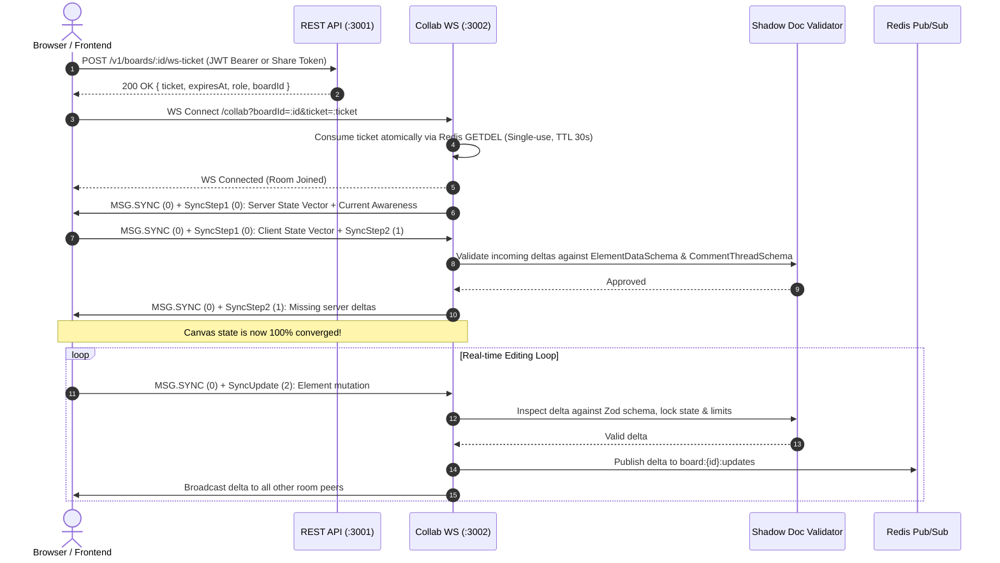

# Real-Time Collaborative Protocol & CRDT Specification — Whiteboard

This document specifies the real-time synchronization protocol, CRDT data model (Yjs), WebSocket message wire format, and authoritative server validation rules for the Whiteboard architecture.

---

## 🧠 CRDT Data Model (Yjs)

Each whiteboard room is represented by a shared `Y.Doc`. The document state is partitioned into three root data structures (`getDocRoots(doc)`):

```
Y.Doc (Room State)
│
├── elements: Y.Map<string, Y.Map<unknown>>
│   ├── "elem-id-1" -> Y.Map { id, type: "rect", x, y, w, h, rotation, z, style: Y.Map, createdBy }
│   ├── "elem-id-2" -> Y.Map { id, type: "arrow", points, startBinding, endBinding, style: Y.Map, ... }
│   └── ...
│
├── meta: Y.Map<unknown>
│   └── Board-level metadata
│
└── comments: Y.Array<CommentThread>
    └── [ { id, elementId, x, y, resolved, messages: [...] }, ... ]
```

### 1. `elements` (`Y.Map<string, Y.Map<unknown>>`)
- Keyed by unique element identifier (`id`, matching the inner `elementMap.get("id")`).
- Guarantees $O(1)$ lookups and property updates.
- Each element's `style` is stored as a nested `Y.Map<unknown>` (`fill`, `stroke`, `strokeWidth`, `opacity`) so concurrent style property edits merge without overwriting sibling style attributes.
- Visual stacking order (Z-index) is stored directly on each element via the `z` property using **fractional indexing strings** (e.g. `'a0'`, `'a1'`). Inserting an element between two existing elements only requires generating a midpoint fractional string via `fractional-indexing`.

### 2. `comments` (`Y.Array<CommentThread>`)
- Stores anchored or canvas-coordinate comment threads validated against `CommentThreadSchema`.

---

## 🔄 WebSocket Synchronization Protocol

The protocol is built on top of standard `y-protocols` (`y-protocols/sync` and `y-protocols/awareness`) and binary encoding via `lib0`.

### Message Types Wire Format

Messages are transmitted as binary `Uint8Array` frames prefixed with an outer message type varuint (`MSG`), followed by protocol-specific sub-type varuints:

| Outer `MSG` | Sub-Type | Name | Payload | Direction | Purpose |
| :--- | :--- | :--- | :--- | :--- | :--- |
| `0` (`MSG.SYNC`) | `0` | `SyncStep1` | Encoded State Vector | Client $\leftrightarrow$ Server | Handshake: "Here is what I already have." |
| `0` (`MSG.SYNC`) | `1` | `SyncStep2` | Encoded Update Delta | Client $\leftrightarrow$ Server | Response: "Here is what you are missing." |
| `0` (`MSG.SYNC`) | `2` | `SyncUpdate` | Incremental Delta | Client $\leftrightarrow$ Server | Real-time propagation of live canvas edits. |
| `1` (`MSG.AWARENESS`) | — | `Awareness` | Encoded Awareness Update | Client $\leftrightarrow$ Server | Cursors, user presence, viewport, and selections. |
| `2` (`MSG.AUTH`) | — | `Auth` | Auth / Error Signal | Server $\rightarrow$ Client | Authentication or permission error notification. |
| `3` (`MSG.QUERY_AWARENESS`)| — | `QueryAwareness` | Empty / Query | Client $\leftrightarrow$ Server | Requests current awareness states from peers. |

### Connection Handshake Lifecycle



---

## 🛡️ Authoritative Server Shadow Document Validation

To prevent malicious clients from corrupting the collaborative document or injecting malformed payloads, the Collab Server maintains an in-memory **Shadow Document** (`YjsValidatorService`):

1. **Schema Integrity (`.strict()`)**:
   - Every updated element is decoded and validated against `ElementDataSchema` (Zod `.strict()`), and every comment thread against `CommentThreadSchema`.
   - Unknown properties or mismatched `id !== key` entries are rejected.
   - Required fields (`id`, `type`, `x`, `y`, `w`, `h`, `z`, `style`, `createdBy`) must conform to length, coordinate, and type constraints. Inline `data:` URLs in `IMAGE.src` are blocked.

2. **Element Lock Enforcement**:
   - If an existing element in the authoritative room document has `locked: true`, any transaction that deletes or modifies that element without unlocking it (`locked: false`) is rejected.

3. **Capacity Limits**:
   - Hard cap of **5,000 elements** (`LIMITS.MAX_ELEMENTS`) and **500 comments** (`LIMITS.MAX_COMMENTS`) per room.
   - Element deletions remain permitted even if a room is at capacity so users can recover space.

4. **Role-Based Operation Filtering**:
   - Users with `VIEWER` permission role are strictly prohibited from submitting `SyncStep2` or `SyncUpdate` mutations.

---

## 📡 Live Presence & Awareness Protocol

Awareness messages (`MSG.AWARENESS = 1`) handle transient, non-persistent collaboration states validated against `PresenceStateSchema` and replicated across Collab Server instances via `board:{id}:awareness`:

```ts
interface PresenceState {
  user: {
    id: string;     // Enforced by server from authenticated session
    name: string;
    color: string;
    role: 'OWNER' | 'EDITOR' | 'VIEWER'; // Enforced by server
    avatar?: string;
  };
  cursor?: {
    x: number;      // World coordinates
    y: number;      // World coordinates
    tool?: string;
  };
  selection?: string[];
  viewport?: {
    pan: { x: number; y: number };
    zoom: number;
  };
  draft?: Record<string, unknown> | null;
}
```

---

## 💾 Persistence Worker & Snapshot Compaction

The `PersistenceService` runs an asynchronous, debounced worker to efficiently persist board state to PostgreSQL without blocking WebSocket latency:

```
WebSocket Updates
      │
      ▼
InMemory Buffer Queue (2s debounce or 50 deltas threshold)
      │
      ▼
Y.mergeUpdates(bufferedDeltas) ──> Single Write to PostgreSQL (doc_updates)
      │
      ▼ (Periodic 5-min snapshot or manual snapshot)
Compress Y.encodeStateAsUpdate(doc) ──> Write to PostgreSQL (snapshots) & prune older doc_updates
```

### Origin Tagging Invariant
When loading or hydrating a room from PostgreSQL:
- The server applies stored updates with transaction origin tag `STORAGE_INIT_ORIGIN` (`'storage-init'`).
- The persistence listener ignores transactions where `origin === 'storage-init'`, preventing circular re-saving of existing database state.
