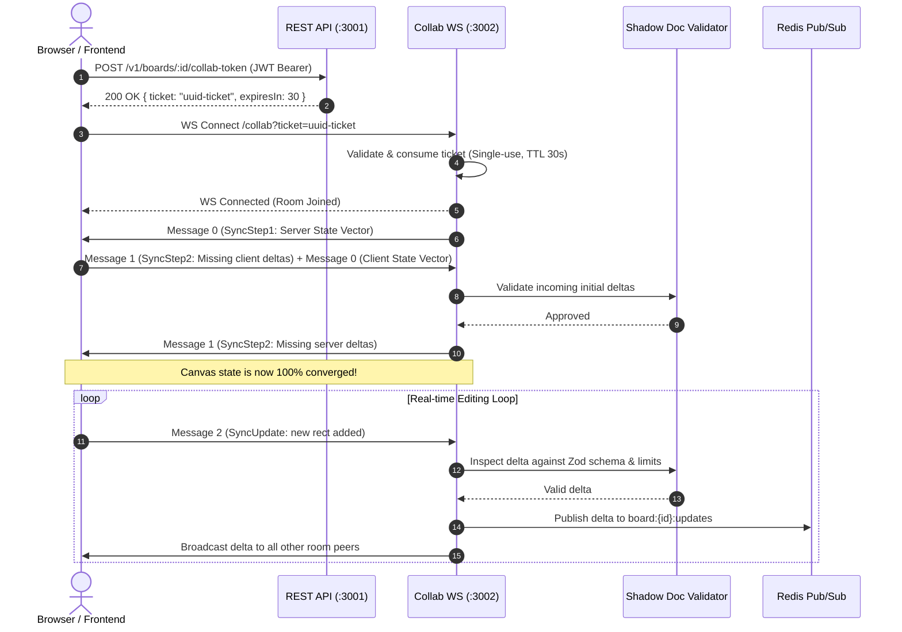

# Real-Time Collaborative Protocol & CRDT Specification — Whiteboard

This document specifies the real-time synchronization protocol, CRDT data model (Yjs), WebSocket message wire format, and authoritative server validation rules for the Whiteboard architecture.

---

## 🧠 CRDT Data Model (Yjs)

Each whiteboard room is represented by a shared `Y.Doc`. The document state is partitioned into two core data structures:

```
Y.Doc (Room State)
│
├── elements: Y.Map<string, ElementData>
│   ├── "elem-uuid-1" -> { id, type: "rect", x, y, w, h, z, style, createdBy }
│   ├── "elem-uuid-2" -> { id, type: "arrow", startBinding, endBinding, ... }
│   └── ...
│
└── order: Y.Array<string>
    └── ["elem-uuid-1", "elem-uuid-2", ...] (Ordered by fractional index `z`)
```

### 1. `elements` (`Y.Map<string, ElementData>`)
- Keyed by unique element UUID (`id`).
- Guarantees $O(1)$ lookups and property updates.
- Under concurrent modifications to different properties of the same element, Yjs resolves updates deterministically using Lamport timestamps and client IDs.

### 2. `order` (`Y.Array<string>`)
- Maintains the visual stacking order (Z-index).
- Uses **fractional indexing strings** (e.g. `'a0100'`, `'a0101'`).
- Inserting an element between two existing elements requires only generating a midpoint fractional string, avoiding mass re-indexing of other elements.

---

## 🔄 WebSocket Synchronization Protocol

The protocol is built on top of standard `y-protocols` and binary encoding via `lib0`.

### Message Types Wire Format

Messages are transmitted as binary `Uint8Array` frames prefixed with a message type byte:

| Byte | Name | Payload | Direction | Purpose |
| :--- | :--- | :--- | :--- | :--- |
| `0` | `SyncStep1` | Encoded State Vector | Client $\leftrightarrow$ Server | Handshake: "Here is what I already have." |
| `1` | `SyncStep2` | Encoded Update Delta | Client $\leftrightarrow$ Server | Response: "Here is what you are missing." |
| `2` | `SyncUpdate` | Incremental Delta | Client $\leftrightarrow$ Server | Real-time propagation of live canvas edits. |
| `3` | `Awareness` | Encoded Awareness State | Client $\leftrightarrow$ Server | Cursors, user presence, and selections. |

### Connection Handshake Lifecycle



---

## 🛡️ Authoritative Server Shadow Document Validation

To prevent malicious clients from corrupting the collaborative document or injecting malformed payloads, the Collab Server maintains an in-memory **Shadow Document**:

1. **Schema Integrity**:
   - Every updated element is decoded and validated against `ElementDataSchema` (Zod).
   - Unknown properties are stripped or rejected.
   - Required fields (`id`, `type`, `x`, `y`, `w`, `h`, `z`, `style`, `createdBy`) must conform to length, coordinate, and type constraints.

2. **Capacity Limits**:
   - Hard cap of **5,000 elements** per room.
   - If a client delta attempts to insert elements beyond the cap, the update is rejected and not broadcast to peers.

3. **Role-Based Operation Filtering**:
   - Users with `VIEWER` permission role are strictly prohibited from submitting `SyncUpdate` ops.
   - Any write attempt by a viewer immediately triggers socket termination.

---

## 📡 Live Presence & Awareness Protocol

Awareness messages (Message Type `3`) handle transient, non-persistent collaboration states:

```ts
interface AwarenessState {
  user: {
    id: string;
    name: string;
    color: string;
    avatarUrl?: string;
  };
  cursor: {
    x: number; // World coordinates
    y: number; // World coordinates
  } | null;
  selectedElementIds: string[];
}
```

### Remote Cursor Interpolation (LERP)
- Clients broadcast cursor position throttled at ~30Hz to conserve network bandwidth.
- Receiving clients apply linear interpolation (LERP) across animation frames:
  $$p_{\text{current}} = p_{\text{current}} + (p_{\text{target}} - p_{\text{current}}) \times \alpha$$
- Produces silky smooth 60 FPS remote cursor motion without jitter.

---

## 💾 Persistence Worker & Snapshot Compaction

The `PersistenceService` runs an asynchronous, debounced worker to efficiently persist board state to PostgreSQL without blocking WebSocket latency:

```
WebSocket Updates
      │
      ▼
InMemory Buffer Queue (500ms debounce or 50 deltas threshold)
      │
      ▼
Y.mergeUpdates(bufferedDeltas) ──> Single Write to PostgreSQL (BoardUpdate)
      │
      ▼ (After 100 updates threshold)
Compress Y.Doc.encodeStateAsUpdate() ──> Write to BoardSnapshot
```

### Origin Tagging Invariant
When loading or hydrating a room from PostgreSQL:
- The server applies stored updates with transaction origin tag `'init'`.
- The persistence listener ignores transactions where `origin === 'init'`, preventing circular re-saving of existing database state.
