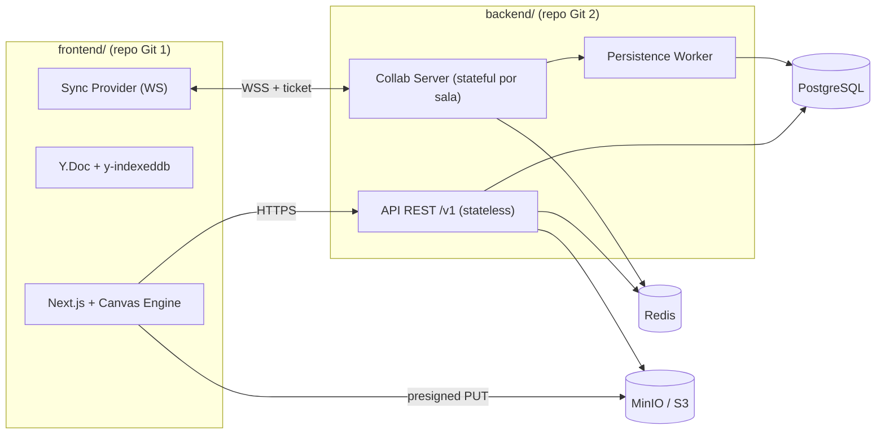

# Arquitetura

## Princípios
- **API stateless** e **Collab stateful por sala**: escalam e são isolados de forma independente.
- **CRDT (Yjs)** para convergência sem coordenação central; servidor autoritativo para autorização e validação.
- **Dois repositórios**; o contrato é versionado em `shared/` + fixtures binárias de protocolo.

## Contrato entre os repositórios
| Contrato | Fonte da verdade | Consumidor | Verificação |
| --- | --- | --- | --- |
| REST | OpenAPI do backend (`/v1/docs-json`) | `npm run gen:api` (frontend) | tipagem do cliente gerado |
| Protocolo WS e constantes | `backend/src/shared/protocol.ts` | `frontend/src/shared/protocol.ts` | `fixtures/protocol/constants.json` |
| Schema do Y.Doc | `backend/src/shared/schema.ts` | cópia no frontend | fixtures `doc-*.json` aplicadas via Yjs |
| Versões | `backend/src/shared/version.ts` | cópia no frontend | `sync:shared:check` no CI |

## Portas locais
| Serviço | Porta |
| --- | --- |
| frontend | 3000 |
| api | 3001 |
| collab | 3002 |
| postgres | 5442 (host) → 5432 |
| redis | 6379 |
| minio | 9000 / 9001 |

## Divergências deliberadas em relação ao documento funcional
| Doc | Realidade | Motivo |
| --- | --- | --- |
| Monorepo pnpm + Turborepo (§18) | 2 repos + npm | Decisão do projeto (ADR-000) |
| MinIO oficial (§19) | `bitnamilegacy/minio` apenas em dev local | Imagens oficiais do MinIO deixaram de ser publicadas |
| Imagens distroless (§14.9) | `node:22-alpine` + usuário não-root na fundação | Hardening na task T9.9 |
